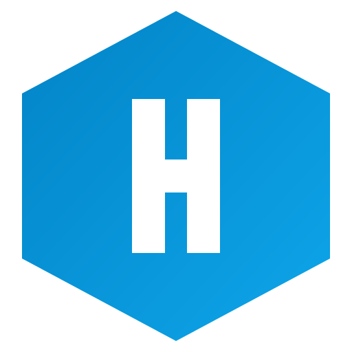

# Hydron plugin for Claude



## What is Hydron

Hydron is an AI-powered deployment platform that gives you dedicated servers with root SSH access. Deploy applications from Git repositories, run open-source software, build custom infrastructure, or run LLM models on GPU servers.

Hydron helps with the full deployment lifecycle: code analysis, infrastructure planning, server provisioning, and deployment.

Your setup is standard Docker, so you can move it to your own machine at any time.

## What this plugin does

The plugin teaches Claude how to use the Hydron MCP server through three skills:

- **deploy** — deploy an application, Git repository, Docker image, open-source software, or LLM model to a dedicated server, including redeploys and custom domains.
- **infrastructure** — plan, size, price, and provision dedicated server infrastructure, with or without code to deploy.
- **servers** — browse the server catalog, order servers, inspect inventory, reboot, reinstall, terminate, and check billing.

## How it connects

The plugin connects to Hydron's remote MCP server at `https://mcp.hydron.app/mcp`. Authentication uses OAuth 2.0: the first time Claude calls a Hydron tool you are sent to your browser to authorize the connection with your Hydron account. No API keys are stored in the plugin.

To disconnect, revoke the connection under **Settings → Connected apps** in Hydron.

## ⚠️ Costs and approval

This plugin can order paid dedicated servers and GPU servers on your behalf. Dedicated servers are billed monthly; GPU servers are billed hourly for as long as they exist.

Claude will always show the cost and ask for your confirmation in the conversation before any purchase, and Hydron shows its own approval dialog as a second check. Destructive actions such as server termination or an OS reinstall are also confirmed with you first.

## Example prompts

- "Deploy https://github.com/TryGhost/Ghost to my server"
- "Set up infrastructure for a database cluster with replication"
- "I pushed new changes to my Ghost repo. Deploy the latest version."
- "Show me my servers and what's running on them"
- "Set up the domain blog.example.com for my Ghost deployment"

### What it won't do

- "Deploy my app to AWS" — Hydron deploys only to Hydron dedicated servers, not to third-party cloud providers.
- "Set up the domain blog.example.com for my project" — a custom domain can only be attached after the project has been deployed.
- "Redeploy the latest code to my server" — a redeploy needs an existing infrastructure plan; plan and deploy first.

## Setup

1. Install the plugin from the Claude directory, or in Claude Code run:

   ```
   /plugin install hydron@claude-community
   ```

2. When Claude first uses a Hydron tool, connect your Hydron account in the browser when prompted.
3. Ask Claude to deploy something, plan infrastructure, or show your servers.

## Troubleshooting

- **Authorization keeps looping** — open Hydron, revoke the connection under Settings → Connected apps, then reconnect from Claude.
- **"No infrastructure plan exists"** — run the `infrastructure` skill first (ask Claude to plan servers for the project), then deploy.
- **Domain setup fails before deployment** — deploy the project first, then attach the custom domain.

## Links

- Docs: https://hydron.app/docs/
- Privacy policy: https://hydron.app/privacy/
- Terms of service: https://hydron.app/terms/
- Support: https://hydron.app/contact/
- Discord: https://discord.gg/2TuKx4R3

## Data

The plugin sends only the requests you make to Hydron's API. No conversation data is collected by the plugin.
